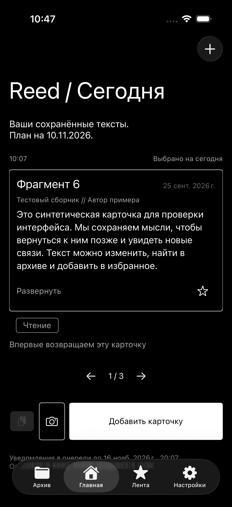
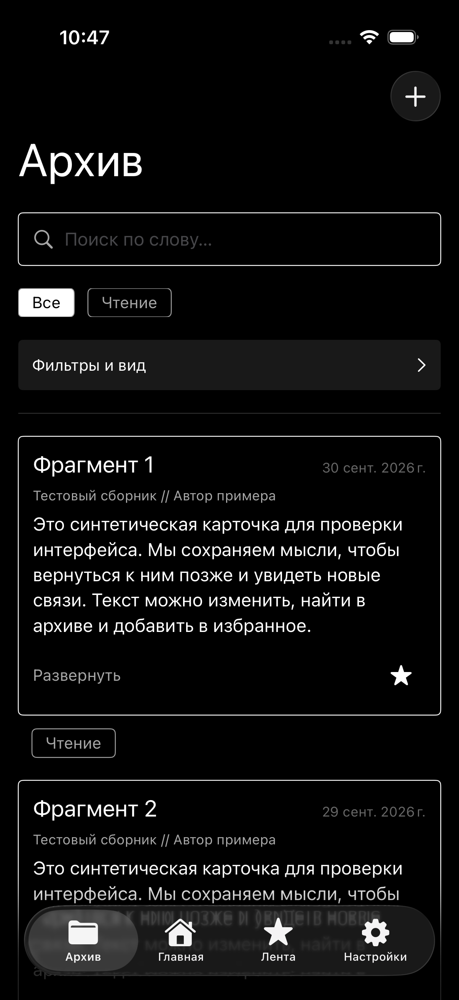
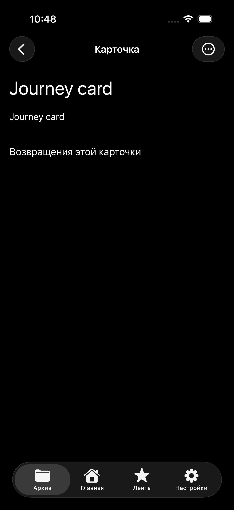
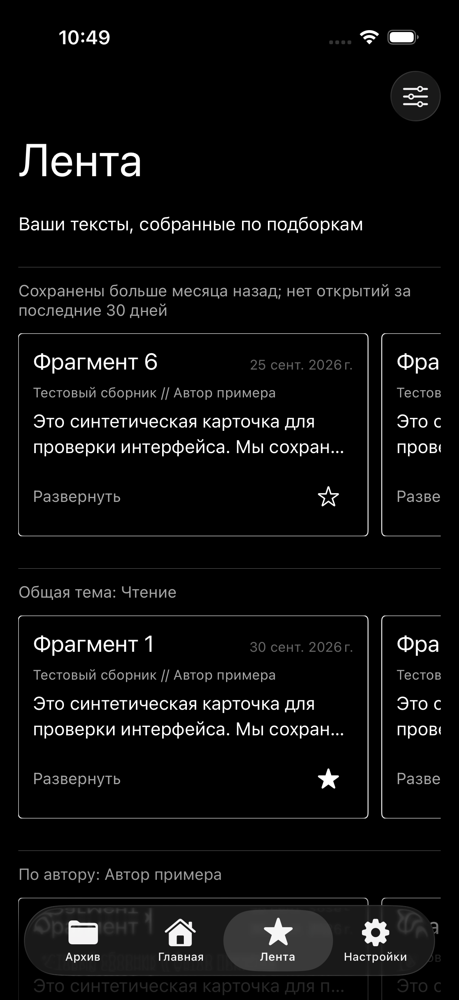
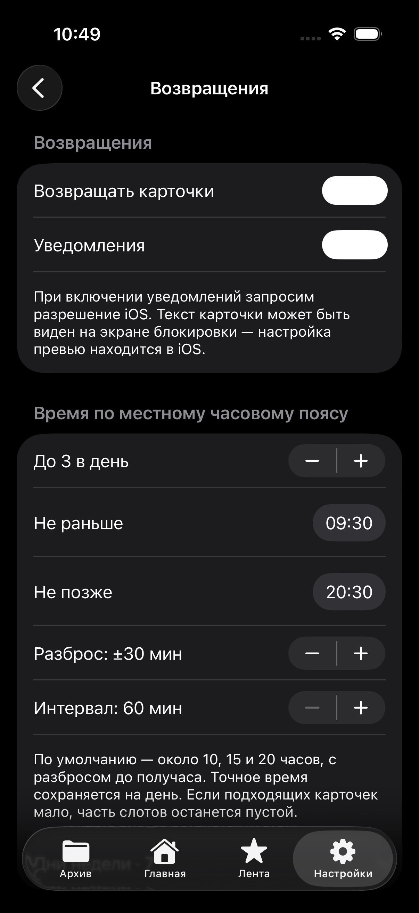

# Экраны прототипа

Снимки из успешного [UI-прогона](https://github.com/Dunchekk/reed/actions/runs/42915851079)
на iPhone 17 Pro Simulator. Только синтетические данные; аппаратные разрешения,
камера и доставка настоящих уведомлений этим сценарием не проверяются.

Изображения экспортированы из XCTest без изменения. Нативные панели и элементы
управления зависят от версии iOS; шрифт приложения — системный San Francisco.

| Главная | Архив |
| --- | --- |
|  |  |

| Карточка | Лента |
| --- | --- |
|  |  |

## Возвращения

Три автоматических слота выбираются около 10, 15 и 20 часов, по умолчанию
с разбросом до получаса. Выбранное время сохраняется на день.
